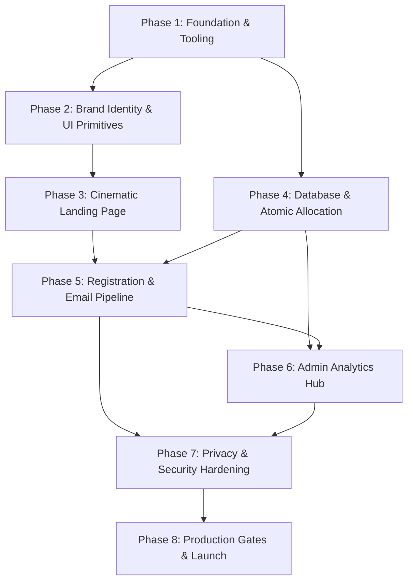

# Project Roadmap: FitKarma Pre-Launch Platform

## Milestone & Phase Structure

This roadmap organizes the development of the FitKarma pre-launch marketing site and VIP beta-registration platform into **8 sequential phases** under fine granularity, providing continuous verification, security checks, and bilingual parity at each step.

---

### Phase 1: Foundation, Tooling & Locale Routing
- **Goal:** Establish a rock-solid, type-safe Next.js App Router environment with strict environment parsing and bilingual locale routing (`/en`, `/hi`).
- **Scope & Deliverables:**
  - Initialize Next.js 15+ App Router with TypeScript and Tailwind CSS.
  - Setup ESLint, PostCSS, and Prettier configurations.
  - Configure Zod-based environment variable validation (`src/lib/env.ts`) and create `.env.example`.
  - Implement subpath locale routing (`/en`, `/hi`) in Next.js middleware with automated browser language detection and default fallback.
  - Create message catalogs (`src/messages/en.json`, `src/messages/hi.json`) and message loading helpers.
- **Requirements Covered:** `ARCH-01`, `ARCH-02`, `ARCH-04`, `I18N-01`, `I18N-02`.
- **Dependencies:** None (Greenfield baseline).
- **Verification:** `pnpm dev` boots, `/en` and `/hi` routes respond with respective localized strings, `pnpm tsc` and `pnpm lint` pass with 0 errors.
- **Status:** Complete (Verified in 01-VERIFICATION.md)

---

### Phase 2: Brand Identity, Tokens & Reusable UI Primitives
- **Goal:** Codify FitKarma's approved visual identity suite, design tokens, Indian cultural nuances, and atomic UI components adhering to the hybrid futuristic + cinematic product launch style.
- **Scope & Deliverables:**
  - Define custom Tailwind theme tokens: Canvas (`#0D0F12`), Brand Accent (`#65C94B`), Vibrant Green (`#36C96A`), Warm Turmeric/Brass Gold (`#D6A84B`), and glassmorphism borders/shadows.
  - Implement subtle Indian aesthetic textures (subtle geometric jaali / mandala lattice ambient backdrop patterns) and desi portion icons (katori, thali, roti, tadka flame).
  - Integrate approved vector branding into `public/brand/` (`fitkarma-mark.svg`, `fitkarma-primary-dark.svg`, `fitkarma-wordmark-dark.svg`, etc.).
  - Build core navigation and layout components: `Header` with language switcher and sticky glass blur, `Footer` with legal/social navigation, and responsive container wrappers.
  - Build UI primitives: `Button` (glow/solid/outline variants), `Card` (glass and elevated), `Badge` (rollout status badges), `Input`, and `PhoneMockup3D` (floating 3D device frame primitive with perspective tilt and dynamic rim lighting).
- **Requirements Covered:** `LAND-01`, `LAND-02`, `LAND-08`, `A11Y-01`, `A11Y-02`, `A11Y-03`.
- **Dependencies:** Phase 1 (Completed).
- **Verification:** Interactive UI components render cleanly on dark background, pass WCAG AA contrast (4.5:1), and keyboard focus rings are visible.
- **Status:** Planned (3 plans across 3 waves)

---

### Phase 3: Cinematic Landing Page & Moat Storytelling
- **Goal:** Deliver an inspiring, high-converting homepage demonstrating FitKarma's unique value proposition, 3D device visualizations, and India-first differentiators.
- **Scope & Deliverables:**
  - **Hero Section**: Cinematic headline *"India's AI-powered Fitness and Wellness Ecosystem"*, value narrative, VIP founder CTA, live capacity badge, and a hero **floating 3D perspective phone mockup** displaying FitKarma's live ambient home dashboard.
  - **Problem-Solution Section**: Contrast Western calorie-counting rigidity with FitKarma's India-native design (home-cooked meals, katoris, fasting support).
  - **Feature Bento Grid with 3D Depth**: Highlighting the 5 core moats with interactive 3D perspective frames:
    1. WhatsApp Hinglish voice & text meal logging (with authentic voice waveform visualizer: *"Bhai 2 roti aur dal tadka log kar de"*)
    2. Indian nutrition intelligence (interactive Tadka oil slider, roti/idli portion selector, 500+ regional recipes)
    3. Daily Intelligence Package (DIP) contextual feed
    4. Offline-first privacy vault (SQLCipher encrypted storage)
    5. Family Care dashboard & telemetry sharing
  - **Illustrative Badges & Rollout Labels**: Every mockup screen explicitly badged with *"Illustrative preview"*; feature statuses strictly using `In beta`, `Rolling out during beta`, or `Planned within the beta programme`.
  - **Trust Strip & How It Works**: 3-step registration walkthrough and foundational health integrity statement.
  - **FAQ Accordion**: 6 key questions regarding beta selection, safety, devices, and rollout.
  - **SEO & Metadata**: Title, description, OpenGraph tags, canonicals, `robots.txt`, and `sitemap.ts`.
- **Requirements Covered:** `LAND-02`, `LAND-03`, `LAND-04`, `LAND-05`, `LAND-06`, `LAND-07`, `LAND-08`, `I18N-03`, `PERF-01`, `PERF-02`.
- **Dependencies:** Phase 2.
- **Verification:** Complete landing page renders in English and Hindi without missing translations; Lighthouse score > 90 across Performance, SEO, and Accessibility.
- **Status:** Pending

---

### Phase 4: Database Architecture & Atomic Seat Allocation
- **Goal:** Construct a robust PostgreSQL schema in Supabase with database-enforced row security and an atomic seat allocation transaction strictly enforcing the 1,000 Phase 1 limit.
- **Scope & Deliverables:**
  - **Database Migration 001**: Tables for `beta_applications`, `phase_config`, `beta_audit_log`, and `email_outbox` with constraints and indexes.
  - **Row Level Security (RLS)**: Enforce strict RLS on all tables, preventing public read/write access to PII; allow only authenticated/service-role server executions.
  - **Database Migration 002 (Atomic Function)**: Implement PostgreSQL function `claim_beta_seat(p_application_id UUID)`:
    - Atomically counts existing `phase1_accepted` rows with `FOR UPDATE` lock on `phase_config`.
    - If count < 1,000, allocates seat as `phase1_accepted` and increments counter.
    - If count >= 1,000, allocates seat as `phase2_waitlist`.
    - Idempotent: returns current status without re-allocating if already verified.
  - **Auto-Promotion Function**: Implement trigger or procedure to automatically promote the earliest verified Phase 2 applicant when a Phase 1 seat is withdrawn (D-029).
  - **Supabase Server Client**: Setup server-side Supabase client wrapper with type generation (`src/lib/supabase/database.types.ts`).
- **Requirements Covered:** `ARCH-03`, `ALLOC-01`, `ALLOC-02`, `ALLOC-03`, `ALLOC-04`, `ALLOC-05`, `SEC-03`.
- **Dependencies:** Phase 1.
- **Verification:** Automated concurrency test simulating 50 concurrent seat claims at threshold 999; confirms exactly 1,000 Phase 1 records are created with zero over-allocation.
- **Status:** Pending

---

### Phase 5: Registration Form, Verification Flow & Email Pipeline
- **Goal:** Build the VIP founder registration card, anti-abuse protections, passwordless verification pipeline, and transactional email engine.
- **Scope & Deliverables:**
  - **VIP Registration Card UI**: Floating glass card with live capacity indicator, responsive single/multi-step inputs, and feature preference selector.
  - **Application API (`/api/beta/applications`)**: Zod server validation, honeypot detection, IP rate limiting, and registration creation with status `pending_email_verification`.
  - **Email Service Adapter (`src/lib/email/adapter.ts`)**: Modular email interface supporting Resend API in production and a local JSON/file sink for local development.
  - **Bilingual Email Templates**:
    - Verification magic link / OTP with 15-minute expiration and cooldown timer.
    - Phase 1 Accepted welcome email with founder reference ID and date-neutral onboarding copy.
    - Phase 2 Waitlist confirmation email with position awareness and Phase 2 notice.
  - **Auth Callback Handler (`/auth/confirm`)**: Verifies token via Supabase Auth, invokes atomic `claim_beta_seat`, and redirects to localized status page (`/beta/status?id=...`).
  - **Resend Verification API (`/api/beta/resend-verification`)**: Enforces 60-second cooldown timer between requests.
- **Requirements Covered:** `REG-01`, `REG-02`, `REG-03`, `REG-04`, `EMAIL-01`, `EMAIL-02`, `EMAIL-03`, `EMAIL-04`, `EMAIL-05`.
- **Dependencies:** Phase 3, Phase 4.
- **Verification:** End-to-end registration flow tested: submission -> email sent to sink -> callback clicked -> seat allocated -> status page displayed.
- **Status:** Pending

---

### Phase 6: Role-Protected Admin Analytics Hub
- **Goal:** Equip the founder with an administrative command center to monitor live capacity, registration conversions, feature demand heatmaps, and campaign controls.
- **Scope & Deliverables:**
  - **Admin Auth Guard (`src/lib/auth/admin.ts`)**: Require authenticated Supabase session, verify email against `ADMIN_EMAIL_ALLOWLIST`, and enforce MFA check.
  - **Admin Layout & Navigation (`/admin`)**: Dark glass admin interface separate from public layout.
  - **Capacity & Conversion Metrics**: Live cards showing Phase 1 filled (X/1,000), Phase 2 queue size, daily velocity, and email verification conversion rate.
  - **Feature Demand Heatmap**: Bar chart / ranked distribution of user selections across all 15 survey categories.
  - **Applicant Table**: Paginated, filterable applicant list with masked PII and status management (`withdrawn`, `rejected_abuse`).
  - **Guarded Data Export**: Audited CSV export endpoint requiring explicit admin confirmation, logging event to `beta_audit_log`.
  - **Phase 2 Campaign Controls**: Preview localized email templates and execute dry-run tests for Phase 2 launch.
- **Requirements Covered:** `ADMIN-01`, `ADMIN-02`, `ADMIN-03`, `ADMIN-04`, `ADMIN-05`, `ADMIN-06`.
- **Dependencies:** Phase 4, Phase 5.
- **Verification:** Non-allowlisted users rejected with 403; metrics match database records; CSV export creates an immutable audit record.
- **Status:** Pending

---

### Phase 7: Privacy Compliance, Security & Operational Hardening
- **Goal:** Ensure full compliance with the Digital Personal Data Protection (DPDP) Act 2025, implement self-service erasure, and audit security boundaries.
- **Scope & Deliverables:**
  - **Standalone Legal Pages**: Dedicated `/privacy` and `/terms` routes in English and Hindi detailing data minimization, purpose limitation, and user rights.
  - **Self-Service Erasure ("Erase My Existence")**: API endpoint (`/api/beta/withdraw`) allowing verified users to withdraw their application, anonymizing PII and triggering Phase 2 waitlist auto-promotion.
  - **Security Headers & Middleware**: Enforce Strict CSP, HSTS, X-Frame-Options (DENY), and X-Content-Type-Options (nosniff).
  - **Accessibility & Contrast Pass**: Audit all color pairs and focus states against WCAG 2.1 AA standards.
  - **Automated Integration Test Suite**:
    - Capacity and race-condition tests (`tests/integration/concurrency-capacity.test.ts`).
    - Admin authorization & permission tests (`tests/integration/admin-security.test.ts`).
    - Privacy erasure and redaction tests (`tests/integration/privacy-operational.test.ts`).
- **Requirements Covered:** `PRIV-01`, `PRIV-02`, `PRIV-03`, `PRIV-04`, `SEC-01`, `SEC-02`, `A11Y-01`, `A11Y-02`.
- **Dependencies:** Phase 5, Phase 6.
- **Verification:** All integration tests pass; withdrawal successfully redacts applicant email and promotes next waitlist user; zero High/Critical security vulnerabilities.
- **Status:** Pending

---

### Phase 8: Production Verification & Controlled Launch Gates
- **Goal:** Implement deployment guards, verify production operational readiness, and prepare the controlled Phase 1 launch.
- **Scope & Deliverables:**
  - **Controlled Registration Gate**: Feature flag (`BETA_REGISTRATION_PAUSED`) allowing instant pause of public registration during traffic spikes or maintenance.
  - **Production Health & Smoke Checks**: Automated health check endpoint (`/api/health`) verifying database connectivity and email service availability.
  - **Production Checklist & Runbook**: Verification of HTTPS, domain callbacks, DNS SPF/DKIM/DMARC records for Resend, and Supabase backup schedules.
  - **Phase 2 Transition Playbook**: Documented procedure for opening Phase 2 and dispatching batch invitations without duplicate sends.
- **Requirements Covered:** `ARCH-03`, `PERF-01`, `PERF-03`.
- **Dependencies:** Phase 7.
- **Verification:** Production build succeeds (`pnpm build`); smoke tests verify registration gate toggle; owner launch sign-off criteria fulfilled.
- **Status:** Pending

---

## Roadmap Timeline & Dependencies

